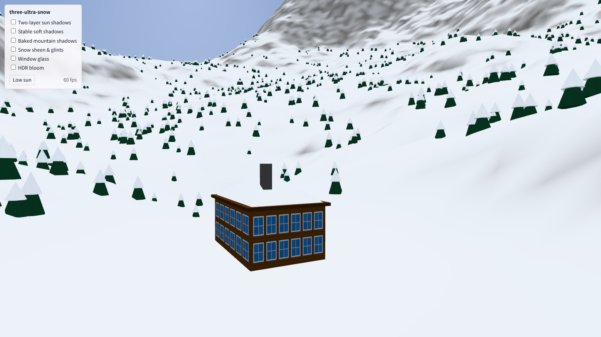
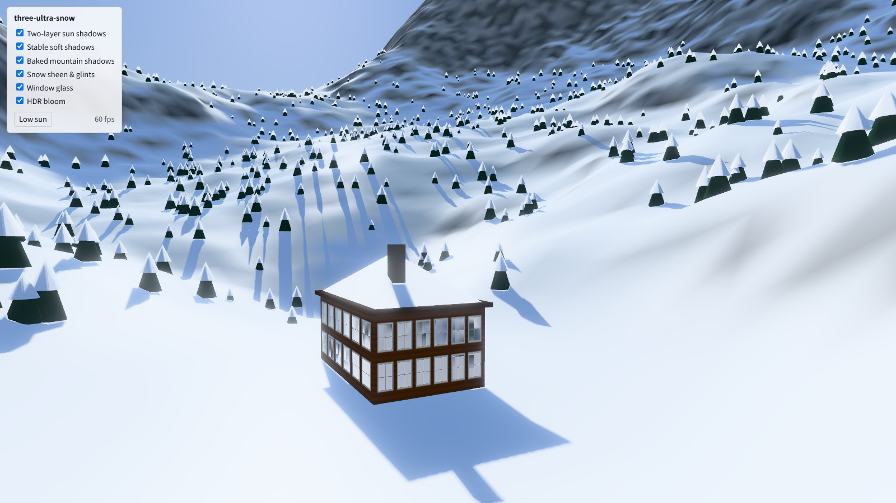
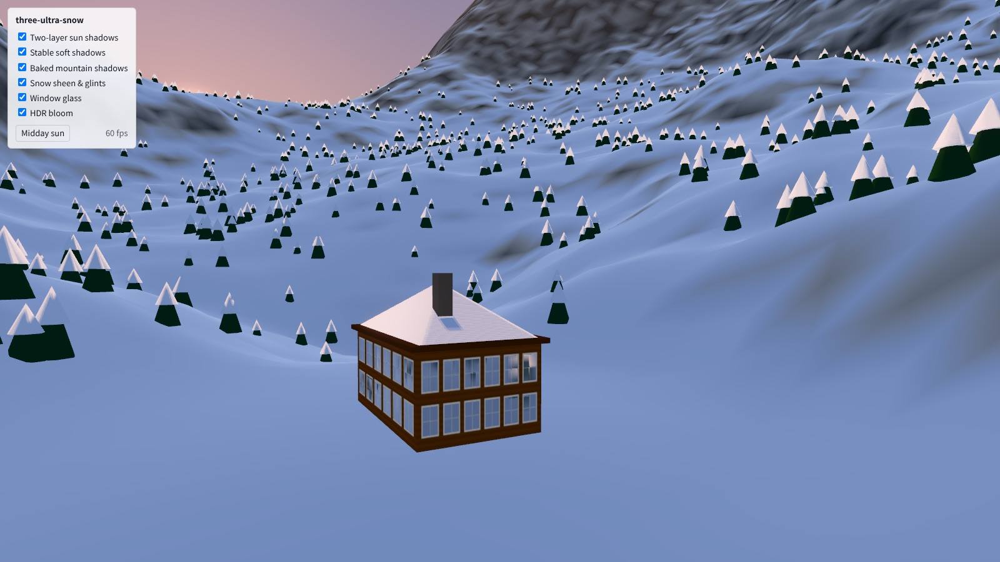

# three-ultra-snow

[](https://github.com/STELIDE/three-ultra-snow)
[](https://github.com/STELIDE/three-ultra-snow/subscription)
[](https://github.com/STELIDE/three-ultra-snow/fork)
[](LICENSE)
[](https://threejs.org)

Snow lighting, sun shadows, window glass and HDR bloom for large outdoor [three.js](https://threejs.org) scenes.

This is the "Ultra" graphics tier of **설원경**, a browser ski game ([ski.stelide.com](https://ski.stelide.com)), taken out of the game engine and packaged as plain ES modules. It doesn't replace three.js. It adds to the standard `MeshLambertMaterial` / `MeshPhongMaterial` pipeline through `onBeforeCompile` and a few shader-chunk patches, so you keep your existing materials, instancing and lights.

| Plain three.js | Ultra, midday | Ultra, low sun |
| --- | --- | --- |
|  |  |  |

**Live demo: [stelide.github.io/three-ultra-snow/demo/](https://stelide.github.io/three-ultra-snow/demo/)**. Each effect can be switched off in the panel to compare. Drag to orbit, scroll to zoom. To run it locally, serve the repository from any static server (`python3 -m http.server`) and open `/demo/`.

## What's inside

| Module | What it does |
| --- | --- |
| `installUltraChunks()` | **Stable soft shadows.** r18x PCF shadows rotate their sample disk with per-pixel noise. Without TAA, shadowed snow looks like halftone dots, so this pins the angle. It also enables the two-layer sun below. |
| `UltraSun` | **Two-layer sun shadow.** A large static map (4096², ±220 m) holds buildings and trees and is re-rendered only when the camera has moved about 66 m. A small map (2048², ±90 m) holds moving things and is re-rendered every frame. The shader multiplies both into one sun, so they read as a single shadow. Both maps are snapped to texels, so edges don't shimmer. Going down the slope fast, the static box is placed ahead, so it re-renders less often. |
| `bakeHorizonShadow()` + `withSunVisibility()` | **Mountain shadows beyond the shadow map.** For a fixed sun, rays are marched over your height field once per terrain vertex. The result is stored as a `sunVis` attribute, and only the sun term is scaled by it. Valleys in a ridge's shadow keep their blue sky light. |
| `withSnow()` | **Snow shading.** A broad sheen toward the sun, and sparkle from 3 cm world cells that act as tiny tilted mirrors (only near the camera, only on bright pixels, never in shadow). Shaded snow turns blue. Distant slopes get grazing-angle Fresnel, and snow on objects gets back-scatter. |
| `GlassReflections` | **Window glass with no extra geometry.** Pixels that are clearly blue in the wall texture are treated as panes. They get a Fresnel reflection of the sky, horizon and ground, or of a cube map captured once. Each pane gets a slightly different tilt, and there is a hard sun highlight. Roofs and night window lights are left alone. |
| `UltraPost` | **HDR finish.** The scene is rendered to half-float, then a dual-Kawase bloom runs down to 1/64 resolution. Tone mapping, sRGB, and a little contrast and saturation are applied at the end. It is a drop-in replacement for `renderer.render()`. |

## Usage

```bash
npm install three-ultra-snow three@0.187
```

Or without a bundler, use an import map:

```html
<script type="importmap">
{ "imports": {
  "three": "https://cdn.jsdelivr.net/npm/three@0.187.0/build/three.module.js",
  "three-ultra-snow": "https://cdn.jsdelivr.net/npm/three-ultra-snow@0.1.0/src/index.js"
} }
</script>
```

```js
import * as THREE from 'three';
import { installUltraChunks, UltraSun, bakeHorizonShadow, withSnow, GlassReflections, UltraPost } from 'three-ultra-snow';

installUltraChunks();                                   // once, before the first render

renderer.shadowMap.enabled = true;
renderer.shadowMap.type = THREE.PCFShadowMap;
renderer.toneMapping = THREE.NeutralToneMapping;
renderer.toneMappingExposure = .85;

const sun = new UltraSun(scene, { direction: new THREE.Vector3(-80, 55, -45), intensity: Math.PI * 1.5 });
sun.addStatic(buildings); sun.addStatic(forest);         // casters, re-rendered rarely
sun.addDynamic(player);                                  // casters, re-rendered every frame
// receivers: mesh.receiveShadow = true, as usual

// terrain: bake mountain shadows, then snow lighting that uses them
terrainGeometry.setAttribute('sunVis', new THREE.BufferAttribute(
  bakeHorizonShadow(heightAt, terrainGeometry.attributes.position.array, sun.dir), 1));
withSnow(terrainMaterial, { ground: true, sunVisibility: true });
withSnow(snowOnTreesMaterial);

const glass = new GlassReflections({ skyTop: '#3d7fd6', skyHorizon: '#d6e7f6' });
glass.apply(lodgeWallMaterial);
glass.captureEnvironment(renderer, scene, townCenter.clone().setY(townCenter.y + 35));   // optional

const post = new UltraPost(renderer);

function frame() {
  sun.update(renderer, camera, { groundHeight: heightAt, velocity: player.velocity });
  post.render(scene, camera);
}
```

Notes:

- **three.js r187 (0.187.x).** The chunk patches use exact string replacement. If a future three.js changes those chunks, the patch is skipped with a console warning rather than breaking your shaders.
- The `UltraSun` sun must be directional light 0 and its shadow-only light must be light 1. Create `UltraSun` before any other `DirectionalLight`.
- Turning shadows off at runtime: set `sun.enabled = false`. Toggling `castShadow` recompiles every material and stalls for a moment, so this moves the shadow boxes into empty space instead.
- Don't combine `withSunVisibility()` and `withSnow({ sunVisibility: true })` on the same material. The second one already includes the first.
- Snow, glass and the horizon bake only work on Lambert and Phong materials.
- On phones, the game uses 2048² / ±150 m (static) and 1024² / ±60 m (dynamic) shadow maps, plus a 128 px glass cube.

---

## 한국어

브라우저 스키 게임 **설원경**의 Ultra 화질을 게임 엔진에서 떼어 내, three.js r187용 ES 모듈로 묶은 것입니다. three.js를 대신하는 렌더러가 아닙니다. 기본 Lambert·Phong 재질에 `onBeforeCompile`과 셰이더 조각 패치로 효과를 더하므로, 쓰던 재질·인스턴싱·빛을 그대로 둘 수 있습니다.

- **그림자 두 겹:** 정지한 물체는 넓은 지도에 가끔만, 움직이는 물체는 좁은 지도에 매 프레임 그립니다. 두 그림자는 한 그림자처럼 보입니다.
- **그림자 점무늬 제거:** TAA가 없을 때 그늘진 눈이 망점처럼 보이던 것을 없앱니다.
- **산 그림자 굽기:** 높이 지도를 따라 해 쪽으로 광선을 쏴서, 그림자 지도 밖의 먼 능선 그림자를 정점마다 굽습니다.
- **눈 셰이딩:** 윤기, 3cm 칸 반짝임, 푸른 그늘, 비스듬한 면의 프레넬을 더합니다.
- **유리창:** 벽 그림 속 파란 칸을 셰이더가 찾아 하늘을 비춥니다.
- **HDR 블룸 후처리:** 장면을 HDR로 그린 뒤 블룸, 톤 매핑, 대비 보정을 합니다.

데모: [stelide.github.io/three-ultra-snow/demo/](https://stelide.github.io/three-ultra-snow/demo/)

설치: `npm install three-ultra-snow three@0.187`

도움이 됐다면 저장소에 ⭐ 스타를 눌러 주세요.

## License

MIT © 2026 STELIDE

If this saved you some shader work, a ⭐ on [the repository](https://github.com/STELIDE/three-ultra-snow) helps others find it.
